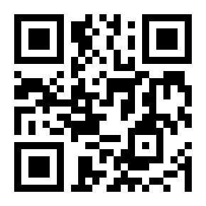

# qr-atomize

Shrink oversized QR code images to **1 pixel per module** — without resampling fuzziness or subpixel-rendering issues.

Takes an oversized QR code (PNG, JPEG, GIF, WebP, BMP, TIFF, ICO), decodes it, and re-renders it at native resolution where each symbol module is exactly 1 pixel. Output is a compact **1-bit PNG** by default, with GIF and raw matrices available as options.

QR codes with embedded logos are supported when the payload can be recovered through error correction. The logo overlay is discarded during atomization, leaving a clean QR code.

# Example

| Input | Output |
|:-----:|:------:|
|  |  |
| 290×290 px input (6.9 KB) | 29×29 px output (197 B) — _97% reduction!_ |

The example above uses the included fixtures: 6,934 bytes → 197 bytes, about **35× smaller** and **10× smaller in each dimension**. Sizes and savings depend on the input image and payload.

## Install

```bash
npm install qr-atomize          # as a dependency
npm install -g qr-atomize       # globally for CLI use
```

## CLI

```bash
# npx (no install needed)
npx qr-atomize input.png

# global install
qr-atomize input.png
qr-atomize input.jpg -o tiny.png
qr-atomize input.gif --border 4 --format gif
qr-atomize input.bmp

# generate directly from text (no image needed)
qr-atomize -t "https://example.com"
qr-atomize --text "Hello 🌍" -o hello.png

# advanced output options
qr-atomize input.png --invert
qr-atomize input.png --format raw -o modules.json
qr-atomize input.png --quiet
```

```text
qr-atomize <input> [options]
qr-atomize -t, --text <content> [options]

Modes:
  <input>                 Re-encode an existing QR code image
  -t, --text <content>    Generate from text (UTF-8 supported)

Options:
  -o, --output <file>   Output path (default: <input>-atomized.png or qr-atomized.png)
  -b, --border <n>      Quiet zone in modules (default: 2, minimum: 1)
  -f, --format <fmt>    Output format: png (default), gif, or raw (JSON)
  -x, --invert          Swap output polarity relative to the input
  -q, --quiet           Suppress non-error output
  -h, --help            Show help
```

The default output extension follows the selected format: `.png`, `.gif`, or `.json`. File input and `--text` are mutually exclusive. Use `--border 4` for a standards-conformant quiet zone; the default of two keeps the image compact.

## Library

```js
// ESM
import atomizeQr from 'qr-atomize';
import { writeFile } from 'node:fs/promises';

const png = await atomizeQr('qrcode.png');
await writeFile('tiny.png', png);
```

```js
// CommonJS: dynamic import works from a .cjs file
async function main() {
  const { default: atomizeQr } = await import('qr-atomize');
  const { writeFile } = require('node:fs/promises');
  const png = await atomizeQr('qrcode.png');
  await writeFile('tiny.png', png);
}
main().catch(console.error);
```

### API

```ts
atomizeQr(input: Buffer | string, opts?: {
  border?: number;                  // quiet zone (default: 2, minimum: 1)
  format?: 'png' | 'gif' | 'raw';    // default: 'png'
  invert?: boolean;                 // swap output polarity relative to input
  text?: string;                    // generate from text instead of an image
}): Promise<Buffer | boolean[][]>
```

- **input** — image buffer or file path. Ignored when `opts.text` is set.
- **returns** — a `Buffer` for PNG/GIF, or a 2D boolean matrix for `raw`. TypeScript overloads narrow the result for a literal format.
- **polarity** — output matches the input by default; `invert: true` swaps black and white. Text generation uses standard black-on-white output unless inverted.

Generate a QR code directly from text (no image required):

```js
const png = await atomizeQr('', { text: 'https://example.com' });
const gif = await atomizeQr('', { text: 'Hello 🌍', format: 'gif' });
```

Use a buffer, adjust the border, or get the raw module matrix:

```js
import { readFile } from 'node:fs/promises';

const png = await atomizeQr(await readFile('qrcode.png'), { border: 4 });
const inverted = await atomizeQr('qrcode.png', { invert: true });
const modules = await atomizeQr('qrcode.png', { format: 'raw' });
// modules[y][x] is true for a dark output pixel, including the border.
```

`atomizeQr` is async and always returns a Promise.

### Sub-module exports

```js
import { decodeInput, reEncode } from 'qr-atomize';

const image = await decodeInput('qrcode.png');
// { width, height, data }: prepared RGBA image data

const png = reEncode('https://example.com', { border: 4, format: 'png' });
// Uint8Array for PNG/GIF; boolean[][] for format: 'raw'
```

`decodeInput` prepares pixels for QR detection, including transparency compositing and enlargement of small images. `reEncode` renders text and accepts `border`, `format`, and `invert` options.

## How it works

1. **Decode** the input image to RGBA pixels, composite transparency onto white, and enlarge small inputs for detection when needed.
2. **Parse** the QR code using finder-pattern detection and error correction, with jsQR as a fallback for difficult images.
3. **Re-encode** the decoded text at `scale: 1` as a 1-bit PNG, GIF, or raw matrix, with a configurable quiet zone.

This is **not** a resizer — it's a decode-and-remint operation. Each output module occupies exactly one pixel, so the result has crisp edges rather than interpolated blur. The text is preserved; the original module pattern, logo overlay, and encoding metadata are not.

PNG is the default because it was consistently smaller than this GIF encoder in our measurements. Lossless WebP was smaller still in the samples, but is currently supported as input only. See the [format size research](docs/research-notes.md) for measurements and their limits.

## Supported input formats

| Format | Extension |
|--------|-----------|
| PNG    | `.png`    |
| JPEG   | `.jpg`, `.jpeg` |
| GIF    | `.gif`    |
| WebP   | `.webp`   |
| BMP    | `.bmp`    |
| TIFF   | `.tiff`, `.tif` |
| ICO    | `.ico`    |

## Text and decoding limits

Image inputs must contain supported UTF-8 text. Unmarked byte segments are assumed to be UTF-8; invalid UTF-8 and explicit non-UTF-8 ECI encodings fail rather than silently changing the text. Arbitrary binary payloads are unsupported. Recovery from logos or damage depends on the image and its remaining error correction capacity.

Encoding tries medium error correction, then low if the payload exceeds medium capacity. If neither level fits, the operation fails explicitly.

## Dependencies

- **`qr`** — QR module generation and primary QR decoding.
- **`fast-png`** — packed 1-bit PNG encoding and decoding.
- **`cross-image`** — image decoding and preparation.
- **`jsqr`** — fallback QR decoding for difficult images.
- **`@cwasm/webp`** — WebP decoding fallback.

## License

MIT
